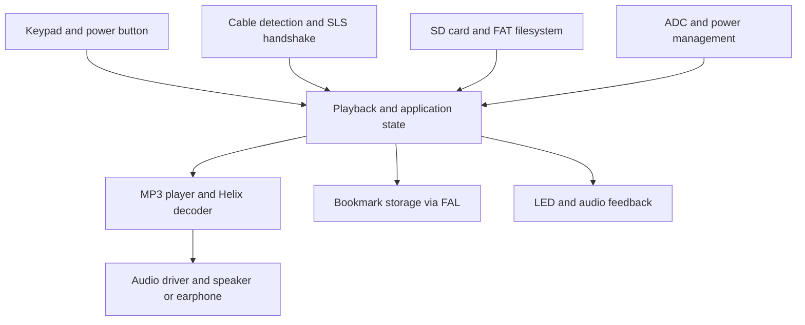

# E3SL Audio Player Firmware

Embedded MP3 audio player firmware for the Bluetrum AB32VG1 platform, built on RT-Thread RTOS. The firmware manages audio playback, hierarchical SD-card content, keypad navigation, bookmarks, audio routing, cable communication and power management.

## 1. Project information

| Item | Details |
| --- | --- |
| Source archive | `E3SL_T23_261028_0618_A.zip` |
| Project directory in archive | `E3SL_T23_261009_1149_A` |
| IDE project name | `3sl_testing_code_v3.2` |
| Target | Bluetrum AB32VG1 (RISC-V) |
| Board support package | AB32VG1-AB-PROUGEN 1.1.1 |
| RTOS | RT-Thread 4.0.5 |
| Language | C, with Python build scripts |
| IDE | RT-Thread Studio |
| Compiler | RISC-V GCC 10.1.0, `riscv64-unknown-elf-` prefix |
| Architecture flags | `-march=rv32imc -mabi=ilp32` |
| Firmware download format | `.dcf` |
| Console | `uart0`, 1,500,000 baud |
| Supplied Debug build timestamp | 28 October 2026, 18:17 (archive metadata) |

The archive name, directory name and IDE project name differ. These are retained as supplied; they do not establish an official release version. This is not an STM32CubeIDE project.

## 2. Main features

- MP3 playback using the Helix decoder and MP3 player package.
- Internal/external SD-card selection and FAT filesystem mounting.
- Section, book and chapter navigation, with numeric-aware sorting and directory caching.
- Play/pause, volume adjustment and held-key seeking.
- Two persistent bookmark slots in on-chip flash, storing volume, content indices, SD-card selection, playback time and content counts.
- 3 × 3 matrix keypad and dedicated power/play button.
- Speaker/earphone switching, DAC beeps and embedded audio notifications.
- Cable detection and SLS handshake handling.
- Battery ADC sampling, LED status indication and sleep/pause handling.

These features are identified from source code; hardware operation has not been independently validated.

## 3. Repository structure

```text
E3SL_T23_261009_1149_A/
├── applications/          # Product application logic
├── board/                 # Board initialization and hardware ports
├── libraries/             # HAL drivers and libraries
├── libcpu/                # CPU-specific implementation
├── packages/              # RT-Thread software packages and vendor SDK
├── rt-thread/             # RTOS source and build tools
├── Debug/                 # Supplied generated build outputs
├── .project               # Eclipse/RT-Thread Studio project metadata
├── .cproject              # IDE compiler and build settings
├── .settings/             # IDE configuration
├── .config                # RT-Thread configuration
├── rtconfig.h             # Firmware configuration macros
├── rtconfig.py            # Compiler and SCons settings
├── SConstruct             # SCons build entry point
├── SConscript             # Build component definitions
├── link.lds               # Linker script
├── pre_build.sh           # Copies firmware packaging inputs
├── makefile.targets       # Additional IDE build targets
├── header.bin             # Input to firmware packaging; retain
├── rtthread.xm            # Firmware packaging script
├── download.xm            # DCF generation script
├── riscv32-elf-xmaker.exe  # Windows vendor packaging utility
├── make_notify_array.py   # Notification audio conversion utility
├── EVSL3_T18.mp3           # Supplied audio asset
└── README.md              # This guide
```

### Application modules

| File (under `applications/`) | Responsibility |
| --- | --- |
| `main.c` | Main RT-Thread entry point; periodic idle delay |
| `play_mode.c/.h` | Keypad scanning, playback, navigation, SD handling and state management |
| `book_mark.c/.h` | Persistent bookmark storage and retrieval |
| `mnt.c` | Mounts `sd0` at `/` using the `elm` filesystem |
| `cable.c/.h` | Cable detection and related state handling |
| `handshake_protocol.c/.h` | SLS handshake implementation |
| `adc1.c` | ADC voltage sampling |
| `dac_beep.c/.h` | Audible feedback |
| `notify_audio.c` | Embedded notification audio data |
| `notify_clip.c/.h` | Notification clip playback |
| `led.c/.h` | LED control |
| `pause_mode.c/.h` | Pause-mode handling |
| `timer1.c/.h` | Timer-related functions |
| `blehr_app.c` | BLE sample/controller initialization code; not evidence of a validated product BLE feature |
| `Gpio_Pins_Defines.h` | Named hardware GPIO assignments |
| `readme.txt` | Earlier application documentation; may differ from current code |

## 4. Hardware interfaces

The following assignments are taken from the current GPIO header and keypad implementation. Confirm them against the production PCB schematic before connecting hardware.

| Interface | Pin(s) |
| --- | --- |
| Keypad rows | PA.0, PA.1, PA.2 |
| Keypad columns | PA.3, PA.4, PF.1 |
| Power/play button | PB.3 |
| Speaker shutdown/audio switch | PB.4 |
| Earphone detection | PF.2 |
| Cable detection | PF.0 |
| Handshake start (SBU) | PE.0 |
| Red LED | PE.1 |
| Green LED | PE.4 |
| SD switching GPIO | PF.5 |
| `MOS_PIN` | PE.6 |
| `SD_EXT` | PE.2 |
| `SD1_SD2` | PE.3 |
| External MOSFET | PA.6 |
| Internal MOSFET | PA.5 |
| `GL_Soc` | PE.5 |

> The older `applications/readme.txt` reverses the red and green LED assignments. This table follows the current header; verify the physical board. Pin assignments alone do not specify electrical voltage levels or connector pinouts.

## 5. Playback controls and SD-card preparation

### Keypad controls

Normal short-press mapping in `play_mode.c` (zero-based software indices):

| Index | Action |
| --- | --- |
| 0 | Previous section |
| 1 | Previous book |
| 2 | Previous chapter |
| 3 | No active normal short-press action in this switch |
| 4 | Volume up |
| 5 | Volume down |
| 6 | Next section |
| 7 | Next book |
| 8 | Next chapter |

The dedicated PB.3 button handles play/power functions. Long-press actions depend on the current operating mode. The current matrix long-press threshold is 1,000 ms. Volume range is 1–100, with normal steps of 7 and held steps of 14. Held seek uses 10-second increments at a configured 400 ms interval.

### SD-card content

Use a backed-up FAT32-formatted card with known-good MP3 files. Example hierarchy:

```text
SD card root/
├── Section_0001/
│   ├── Book_001/
│   │   ├── 001.mp3
│   │   └── 002.mp3
│   └── Book_002/
│       └── 001.mp3
└── Section_0002/
    └── Book_001/
        └── 001.mp3
```

The example follows the source's section/book/chapter structure. Numbered sections can start at zero or one according to the source lookup logic. Use the actual production content layout for final testing. Do not format production cards without a backup.

## 6. Software architecture



This is a conceptual module diagram, not a complete call graph. RT-Thread initializes application modules through `INIT_APP_EXPORT` and other initialization hooks. Consequently, the minimal loop in `main.c` is not the entire firmware execution path.

### Bundled dependencies

| Package | Purpose |
| --- | --- |
| `bluetrum_sdk-latest` | Vendor SDK and platform support |
| `helix-latest` | MP3 decoding |
| `mp3player-latest` | Playback engine |
| `fal-v1.0.0` | Flash abstraction |
| `MultiButton-v1.1.0` | Button event handling |
| `optparse-latest` | Option parsing utility |

Use the bundled package revisions for reproducibility. Avoid updating all packages indiscriminately.

## 7. Development environment setup

### Prerequisites

- Windows PC (recommended because the supplied packaging utility is a Windows executable).
- RT-Thread Studio with RISC-V GCC 10.1.0 and the compatible Bluetrum BSP.
- Python and SCons for optional command-line builds.
- Compatible Bluetrum programming hardware, Downloader utility and target board.
- SD card, audio output and a suitable power supply for functional testing.

Useful upstream references: [RT-Thread](https://github.com/RT-Thread/rt-thread) and [Bluetrum Downloader](https://github.com/BLUETRUM/Downloader).

### Import into RT-Thread Studio

1. Extract the ZIP to a short local path, for example `D:\Firmware\E3SL`.
2. Open RT-Thread Studio and select a workspace.
3. Select **File > Import > General > Existing Projects into Workspace** (menu wording may vary by Studio version).
4. Browse to the extracted folder containing `.project` and `.cproject`.
5. Select `3sl_testing_code_v3.2` and finish the import.
6. Open project properties and verify the RISC-V compiler, include paths and linker script.
7. Replace stale absolute paths referring to the original developer's `D:\RT-ThreadStudio\workspace\...` or toolchain directory with local paths.
8. Select the Debug configuration, clean the project and build it. Review the build console for errors.

Do not create an unrelated STM32 or generic ARM project to import these sources.

## 8. Build firmware

### Method A — RT-Thread Studio (recommended)

1. Right-click the imported project and select **Clean Project**.
2. Select **Build Project**.
3. Confirm compilation and linking finish successfully.
4. Verify the packaging stage runs and produces a fresh `Debug/rtthread.dcf`.
5. Check file timestamps so that an old supplied binary is not mistaken for a newly compiled build.

### Method B — SCons (optional)

From the project root in a configured Windows command prompt:

```bat
set RTT_ROOT=%CD%\rt-thread
set RTT_EXEC_PATH=C:\path\to\RISC-V-GCC\10.1.0\bin
riscv64-unknown-elf-gcc --version
scons -c
scons -j4
```

Replace the example toolchain path and ensure its `bin` directory is on PATH for the version-check command. The SCons configuration uses the bundled RT-Thread tree by default and has a Windows packaging post-action. This alternative has not been executed during documentation review.

### Firmware outputs

| Output | Purpose |
| --- | --- |
| `rtthread.elf` | Linked executable and debugging symbols |
| `rtthread.bin` | Raw firmware binary |
| `rtthread.dcf` | Packaged firmware for Bluetrum Downloader |
| `rtthread.map` | Linker memory map |
| `rtthread.lst` | Generated listing |

The archive already contains these outputs under `Debug/`. The packaging flow uses `header.bin`, `rtthread.xm`, `download.xm` and `riscv32-elf-xmaker.exe`. Do not substitute a raw `.bin` for the `.dcf` without vendor instructions.

## 9. Flash and run

1. Confirm the target hardware is compatible with this firmware and back up any existing firmware or persistent data where supported.
2. Open the Bluetrum Downloader utility.
3. Connect the board using the approved programming interface for the PCB.
4. Select the newly generated `rtthread.dcf` (or the supplied `Debug/rtthread.dcf` for an explicitly approved baseline test).
5. Follow the vendor/board-specific procedure to enter download mode and initiate programming.
6. Wait for successful programming confirmation before disconnecting or resetting the board.
7. Restart the device, insert prepared SD media as appropriate and perform the functional tests below.

The original BSP README specifies DCF download through Bluetrum Downloader. The exact production programming connector, boot-entry sequence and electrical levels are not documented in the supplied project. Although IDE metadata lists ST-LINK, that alone does not establish the correct programming method for the production board.

### Serial diagnostics

The configured console is `uart0` at 1,500,000 baud. Use a compatible serial adapter and verify the board's signal levels and UART pinout before connection. RT-Thread FinSH is enabled. Application commands include:

```text
notify_info
notify_play
```

These commands report notification clip information and play the embedded notification respectively. Availability of console output depends on the board wiring and active configuration.

## 10. Functional verification checklist

Record board serial number, PCB revision, firmware filename/hash, SD-card content revision, tester and date before testing. The following are proposed acceptance checks, not completed test results.

| Test ID | Test | Expected observation | Result |
| --- | --- | --- | --- |
| T01 | Power on | Device initializes without repeated resets | Pending |
| T02 | Internal SD | Known content is detected and playable | Pending |
| T03 | External SD | Supported external card is detected and selected correctly | Pending |
| T04 | MP3 playback | Known-good track plays without unexpected interruption | Pending |
| T05 | Play/pause | Dedicated control responds as intended | Pending |
| T06 | Navigation | Previous/next section, book and chapter work | Pending |
| T07 | Held seek | Forward/rewind behaves correctly at track boundaries | Pending |
| T08 | Volume | Increment, decrement and limits work | Pending |
| T09 | Bookmarks | Saved position and volume restore after restart | Pending |
| T10 | Speaker/earphone | Audio routes correctly on insertion/removal | Pending |
| T11 | Cable detection | Supported cable is recognized; SLS handshake completes where applicable | Pending |
| T12 | LED and beeps | Indicators match approved device behavior | Pending |
| T13 | Battery monitoring | ADC readings agree with measured voltage within approved tolerance | Pending |
| T14 | Sleep/wake | Device enters and exits supported power states | Pending |
| T15 | Missing/invalid SD | Device handles unavailable content without uncontrolled resets | Pending |
| T16 | Repeated operation | Repeated playback, navigation and power cycles remain stable | Pending |

Use the approved product specification for exact timing, current consumption, audio quality and LED acceptance limits; those limits are not established here.

## 11. Troubleshooting

| Problem | Checks |
| --- | --- |
| Project not listed during import | Select the directory containing `.project`, not the ZIP or `Debug/`. |
| Compiler not found | Verify RISC-V GCC installation and local `RTT_EXEC_PATH`/IDE settings. |
| Missing headers or libraries | Confirm bundled packages, RT-Thread and vendor SDK are intact; correct include paths. |
| Linker cannot find `link.lds` | Replace stale absolute paths in IDE settings. |
| Duplicate type definitions | Original BSP notes mention `HAVE_SIGEVENT`, `HAVE_SIGINFO`, `HAVE_SIGVAL` in `cconfig.h`; inspect the actual error before changing configuration. |
| DCF not generated | Inspect post-build logs and confirm packaging scripts, utility and `header.bin` are available. |
| Download fails | Verify target compatibility, programming connection, power and vendor download mode. |
| SD card not mounted | Check FAT format, card detection, `sd0` registration and mount logs. |
| No audio | Check content, volume, audio routing, speaker/earphone connection and `sound0` driver. |
| Bookmark not restored | Check FAL initialization, flash data validity and matching SD content. |
| No serial logs | Check UART selection, baud rate, wiring and voltage compatibility. |

## 12. GitHub repository maintenance

Place this README in the same directory as `.project` and `SConstruct`. Preserve the original BSP README separately, for example as `docs/BSP_README.md`, if replacing it.

Track source files, configuration, linker scripts, required SDK libraries and build inputs. Generated objects, dependency files, maps and local build caches should normally be excluded. Review the supplied `.gitignore`: its broad `*.bin` rule also matches the required `header.bin`. Add an exception for that input before committing. Check that required precompiled vendor libraries are retained and redistribution is permitted.

Suggested additions to `.gitignore` (review before applying):

```gitignore
/Debug/
/build/
/dist/
*.o
*.d
*.elf
*.map
*.lst
*.dcf
*.pyc
*.dblite
*.bin
!/header.bin
```

If distributing approved firmware, attach the DCF to a GitHub Release instead of committing every generated build. Record source commit, toolchain version, target PCB revision, firmware checksum and test status. Do not assume the archive name is an official semantic version.

Example initial commit after reviewing the staged files:

```bash
git init
git add .
git status
git commit -m "Import E3SL firmware and project documentation"
```

Create an authorized repository on GitHub and follow its instructions to add the remote and push. Use a private repository unless public redistribution of the firmware, vendor SDK and audio assets has been approved. Review files for confidential information and credentials before uploading.

## 13. License and documentation status

Several RT-Thread and Bluetrum source files carry Apache-2.0 notices. This does not establish a single license for the complete product firmware, vendor binary libraries or audio assets. Confirm ownership and redistribution permissions before publication.

This README is based on static inspection of the supplied archive, including current source, configuration, build scripts and existing documentation. No firmware rebuild, hardware flash or functional test was performed. The supplied binaries have not been verified against the current source. Production schematics, exact programming instructions and approved acceptance limits remain to be supplied by the project owner.
